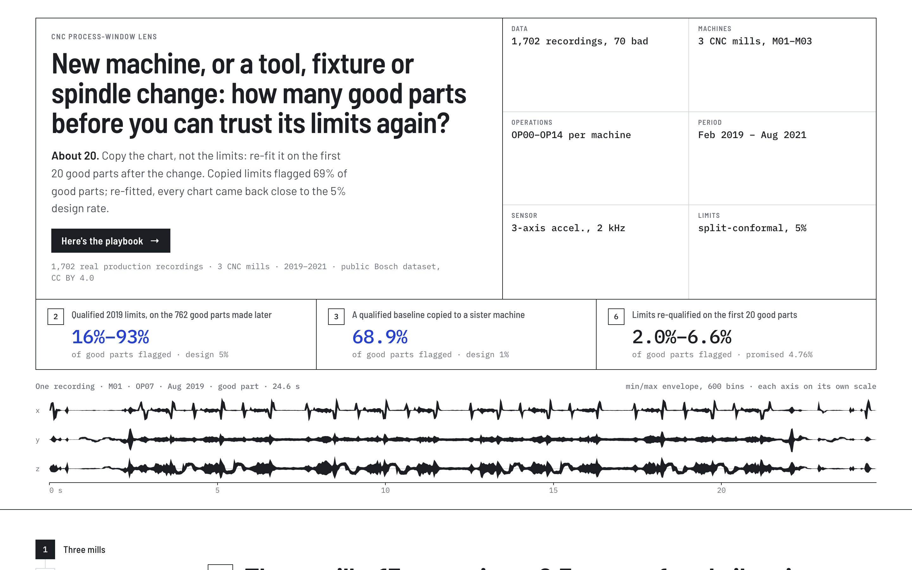
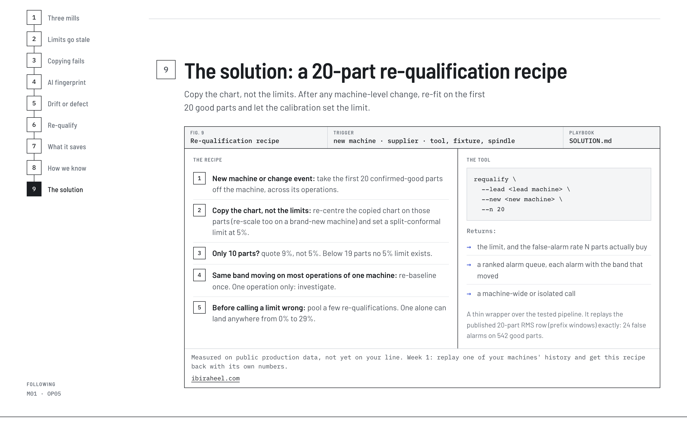
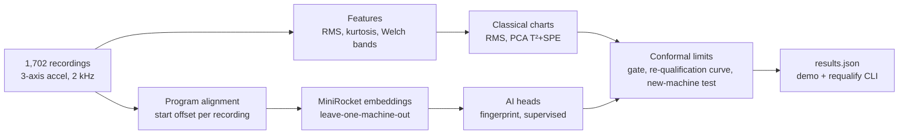

# CNC Process-Window Lens

**How many good parts does a CNC operation need before its control limits can be trusted again? About 20, measured on 1,702 real production recordings from three mills.**

[](tests/)
[](LICENSE)
[](https://github.com/boschresearch/CNC_Machining)
[](requirements.txt)
[](package.json)

<a href="https://ibiraheel.com/demos/cnc-process-window-lens/"></a>

**[Live demo →](https://ibiraheel.com/demos/cnc-process-window-lens/)** · [METHOD.md](METHOD.md) · [SOLUTION.md](SOLUTION.md)

---

## The question

A machining operation moves to a new machine or a second supplier, or comes back from a tool, fixture or spindle change. Its monitoring limits were set once, at qualification. How many good parts do you need before those limits can be trusted again, and how do you tell harmless drift from a real process change?

## The answer

**About 20. Copy the chart, never the limits.** Limits copied unchanged to a sister machine flagged 68.9% of good parts against a 1% design rate. Limits set in 2019 flagged 16–80% of the good parts made later. Re-fitted on the first 20 good parts after a change, every chart came back to 1.5–5.4% against a nominal 4.76%.

## The solution

[SOLUTION.md](SOLUTION.md) is a one-page re-qualification recipe with decision rules, thresholds and a week-1 plan for a real line. The `requalify` tool applies it: give it the lead machine's qualification recordings and the first N good parts from the new or changed machine, and it returns calibrated limits, the false-alarm rate N actually buys, a ranked alarm queue with the frequency band that moved, and a machine-wide or isolated call.



## Key results

All rates are false alarms on confirmed-good parts. Sources: `public/data/results.json` and [METHOD.md](METHOD.md), which has the intervals, equations and caveats.

| Situation | Measured | Design rate |
|---|---|---|
| Qualified limits copied unchanged to a sister machine | **68.9%** [66.6, 71.1] | 1% |
| Copied chart re-centred and re-scaled on the first 10 parts per operation | **7.6%** [5.9, 9.7] | 1% |
| 2019 limits applied to the 762 good parts made later, by chart | **16–80%** | 5% |
| Re-fitted on the first 20 good parts after a change, pooled over 11 machine × periods | **1.5–5.4%** (2.0–6.6% on program-aligned windows) | 4.76% |
| Textbook 3σ limit, leave-one-out inside qualification | **2.2%** [1.4, 3.4] | 0.27% |
| Fewest parts for a 5% split-conformal limit | **19** (10 parts buy 9.09%) | |
| Machine-wide shift on one mill: x-axis 100–178 Hz power | median **+5.2σ** in 13 of 13 operations (sign test p = 2.4×10⁻⁴) | |

## AI vs baseline

The AI is a label-free MiniRocket fingerprint: a nearest-neighbour memory of good 0.5 s vibration windows that never sees a bad part. Every recording is cut to the same point of its NC program, so the model cannot read recording length or start time. Three seeds.

| Test | AI fingerprint | Best classical baseline | Verdict |
|---|---|---|---|
| Ranking bad parts, like-for-like (AUC) | 0.962–0.972 | 0.960 (PCA T²+SPE) | **Tie.** The pre-declared gate was not passed. |
| Catching the 16 later bad parts after a 20-part re-qualification | 11 of 16 at 6.6% false alarms | 10 of 16 (RMS chart) at 5.2% | **Tie.** McNemar p = 1.0 |
| New machine A, 20 reference parts | 13 of 24 | 0 of 24 (re-centred RMS copy) | **Win.** p = 0.0002, but from only 2 timeframes |
| New machine B, 20 reference parts | 6 of 27 | 2 of 27 (re-centred RMS copy) | **Not significant.** p = 0.13 |

The fingerprint matches the best chart; it does not beat it. Its practical edge is that it needs no defect history: append confirmed-good parts and it is up to date. A supervised MiniRocket model trained on the other machines' labelled history caught 25 of 27 and 24 of 24 on the new machines, but at equal false alarms after qualification it catches 2–3 of 16 later bad parts, the same as the RMS chart (3 of 16).

A cycle-time chart appears to catch the most bad parts. It is kept as a baseline only: in this dataset every bad file is shorter than a normal cycle and starts a median 3.8 s later, so length alone ranks bad parts at AUC 0.985. That chart reads how the files were cut, not the machine.

## How it works



Limits are split-conformal: with N reference parts the limit is the ⌈(N+1)(1−α)⌉-th smallest score, which keeps the false-alarm rate at or below α on average over re-qualifications. At N = 20 and α = 5% that is the largest score, so the rate is 1/21 = 4.76%. The tests check this guarantee by simulation.

## Quickstart

**Demo** (reads precomputed JSON, no API keys, no GPU):

```bash
npm install
npm run dev          # http://localhost:5173/demos/cnc-process-window-lens/
npm run build        # static site in dist/, built for /demos/cnc-process-window-lens/
```

**Pipeline and tests** (Python 3.12):

```bash
uv venv .venv --python 3.12 && uv pip install --python .venv/bin/python -r requirements.txt
git clone --depth 1 https://github.com/boschresearch/CNC_Machining ../_downloads/bosch-cnc/repo
DATA=../_downloads/bosch-cnc/repo/data

.venv/bin/python -I pipeline/extract.py     $DATA pipeline/out/features.npz
.venv/bin/python -I pipeline/analyze.py     pipeline/out/features.npz public/data/results.json
.venv/bin/python -I pipeline/diagnostics.py pipeline/out/features.npz public/data/results.json
.venv/bin/python -I pipeline/align.py       $DATA pipeline/out
.venv/bin/python -I pipeline/windows.py     $DATA pipeline/out
.venv/bin/python -I pipeline/embed.py       pipeline/out crop full align   # about 23 min on CPU
.venv/bin/python -I pipeline/ai_eval.py     pipeline/out public/data/results.json

.venv/bin/python -m pytest -q tests        # 77 tests, about 11 s
```

**The re-qualification tool:**

```bash
.venv/bin/python -I pipeline/requalify.py \
  --lead "$DATA/M01/*/good/M01_*_2019_*.h5" \
  --new  "$DATA/M01/*/*/M01_Feb_2021_*.h5" \
  --n 20 --alpha 0.05 --chart rms,t2spe --out requal.json --md requal.md
```

It writes `requal.json` and a one-page `requal.md`. The limit arithmetic works on any per-part score, so spindle load or probe readings could stand in for vibration.

## Repo layout

```
pipeline/            feature extraction, charts, alignment, MiniRocket, evaluation, requalify CLI
tests/               77 pytest checks: conformal guarantee, hand-checked limits, leakage guards, regression
public/data/         precomputed results.json read by the demo
src/                 React + TypeScript guided demo
METHOD.md            equations, assumptions, validation, every table
SOLUTION.md          the re-qualification recipe and week-1 plan
```

## Limitations

- **Small defect samples.** The 16 bad parts made after qualification come from 6 machine × period episodes. When the bootstrap resamples whole episodes, no model passes the gate in any arm or seed.
- **No maintenance log.** The public data has no change events, so the start of each production period stands in for one. The machine-wide shift is a candidate re-baseline until a log confirms it.
- **One re-qualification scatters.** The 20-part limit holds when pooled, but a single re-qualification landed anywhere from 0% to 29% here. Pool several before calling a limit wrong.
- **Dataset artefacts.** Recording length and start offset leak the label. AI results are reported on program-aligned windows, and the cycle-time chart is not counted as evidence.
- **One sensor, three machines.** Every result comes from vibration on three mills in one public dataset. Nothing here has run on another line yet.

## Data

Bosch CNC Machining dataset, [github.com/boschresearch/CNC_Machining](https://github.com/boschresearch/CNC_Machining), licensed [CC BY 4.0](https://creativecommons.org/licenses/by/4.0/). No simulated data is used in the analysis. Please cite:

> Tnani, Feil, Diepold. *Smart Data Collection System for Brownfield CNC Milling Machines: A New Benchmark Dataset for Data-Driven Machine Monitoring.* Procedia CIRP 107 (2022) 131–136. doi:[10.1016/j.procir.2022.04.022](https://doi.org/10.1016/j.procir.2022.04.022)

## Author

**Ibi Raheel** · mechanical engineer building AI tools · [ibiraheel.com](https://ibiraheel.com)
